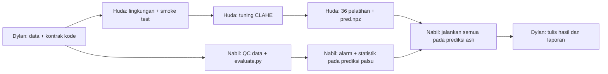

# BUILD-PLAN: rencana utama tim

Proyek: *Peran CLAHE dalam Kesiapan Segmentasi Paru Rontgen Thorax Lintas Rumah Sakit untuk Skrining Tuberkulosis*

Baca urut: README.md, `docs/PROTOCOL.md` (aturan eksperimen), file ini, lalu rencana pribadimu.

| Orang | Fokus | Rencana |
|---|---|---|
| Dylan | Kontrak kode, data, proposal dan laporan, integrasi, review | [BUILD-PLAN-DYLAN.md](BUILD-PLAN-DYLAN.md) |
| Huda | Semua yang melatih model: U-Net, tuning CLAHE, 36 pelatihan, prediksi | [BUILD-PLAN-HUDA.md](BUILD-PLAN-HUDA.md) |
| Nabil | Kualitas data, evaluasi, alarm pergeseran, statistik, gambar dan tabel | [BUILD-PLAN-NABIL.md](BUILD-PLAN-NABIL.md) |

## 1. Cerita proyek dalam lima kalimat

1. Segmentasi paru adalah langkah awal banyak sistem skrining TB lewat rontgen.
2. Model yang bagus di satu rumah sakit sering turun di rumah sakit lain karena alat dan kontras citra berbeda.
3. CLAHE dipakai di mana-mana untuk memperbaiki kontras, tetapi belum diuji pada sumber data yang tidak dilihat model saat latihan.
4. Kita melatih U-Net pada dua sumber, menguji pada sumber ketiga, mengulang untuk ketiganya, dan membandingkan empat perlakuan kontras.
5. Hasil akhirnya bukan hanya "CLAHE menolong atau tidak", tetapi juga **alarm tanpa label** yang memberi tahu rumah sakit baru apakah model aman dipakai.

## 2. Peta ketergantungan

Kunci agar tidak saling menunggu: Nabil mengerjakan semuanya pada **prediksi palsu** (`scripts/make_fake_predictions.py`) selama Huda masih melatih. Saat prediksi asli jadi, cukup mengganti folder masukan.

## 3. Kontrak antar-orang (jangan diubah tanpa kabar)

| Dari | Ke | Berkas | Isi |
|---|---|---|---|
| Dylan | Huda, Nabil | `data/processed.zip` (via Google Drive) | Citra dan mask 256x256, `manifest.csv` |
| Dylan | Huda, Nabil | `src/cxrseg/{preprocess,postprocess,metrics,data}.py` | Fungsi bersama, sudah diuji |
| Huda | Nabil | `results/predictions/{fold}/{scenario}/seed{seed}/pred.npz` | Probabilitas per citra, format di PROTOCOL bagian 6 |
| Huda | Nabil, Dylan | `results/tables/tuning_{fold}.csv`, `results/tables/s3_params.csv` | Skor 12 kombinasi CLAHE dan pemenangnya |
| Nabil | Dylan | `results/tables/*.csv`, `results/figures/*.png` | Tabel dan gambar siap masuk laporan |

## 4. Alur kerja Git

- Cabang: `main` (stabil, hanya Dylan yang menggabungkan), `huda/...`, `nabil/...`, `dylan/...`.
- Satu commit satu perilaku, 50 sampai 450 baris. Subjek `feat|fix|test|docs|chore(scope): hasil dalam kata biasa`.
- Sebelum commit: `python -m pytest -q` harus lolos.
- Data, checkpoint, dan prediksi tidak pernah masuk git (sudah di `.gitignore`). Bagikan lewat Google Drive.
- Jangan commit kunci atau token. Jangan `git push --force`.
- Tarik dulu sebelum mulai (`git pull --rebase`), lalu buka merge request ke `main`.

## 5. Garis waktu usulan

Tanggal pengumpulan akhir belum kami ketahui. Pembagian minggu ini bisa digeser, urutannya yang penting.

| Minggu | Dylan | Huda | Nabil | Gerbang (harus lolos sebelum lanjut) |
|---|---|---|---|---|
| 1 | Data siap dan dibagikan, proposal final | Lingkungan jalan, smoke test satu lipatan | QC data, `evaluate.py` | Smoke test Dice dalam sumber >= 0,90 dan QC tanpa duplikat lintas sumber |
| 2 | Review, siapkan kerangka laporan | Tuning CLAHE 3 lipatan, mulai 36 pelatihan | Alarm A1 dan A2, statistik pada data palsu | `tuning_*.csv` lengkap dan `s3_params.csv` ada |
| 3 | Review, tulis bagian Metode | Selesaikan 36 pelatihan, Attention U-Net bila sempat | Jalankan semua pada prediksi asli, buat tabel dan gambar | 36 `pred.npz` ada, `evaluate.py` jalan untuk semuanya |
| 4 | Tulis Hasil, Diskusi, Kesimpulan, cek angka | Bantu cek ulang hasil, rapikan notebook | Rapikan gambar, referensi, cek ulang angka | Semua angka di laporan bisa dilacak ke satu berkas CSV |

## 6. Prioritas

| Tingkat | Isi | Boleh dilewati? |
|---|---|---|
| P0 | LOSO penuh, 4 skenario, 3 seed, metrik, uji statistik, alarm A1, aturan kesiapan | Tidak |
| P1 | Alarm A2 (entropi), analisis kepekaan ambang gagal, simulasi sampel 50 citra, sensitivitas parameter CLAHE | Boleh bila waktu habis, tulis sebagai batasan |
| P2 | Attention U-Net sebagai pemeriksaan arsitektur | Ya |

## 7. Kriteria sukses proyek (definition of done)

Proyek selesai bila semua ini benar:

1. `scripts/download_data.sh`, lalu `scripts/prepare_data.py`, lalu pelatihan, evaluasi, dan analisis bisa diulang dari repositori bersih tanpa langkah manual tersembunyi.
2. 36 pelatihan penuh selesai, dan setiap lipatan punya `tuning_*.csv`.
3. Ada tabel untuk RM1 (celah generalisasi), RM2 (S0 sampai S3 pada tiap sumber asing dengan p terkoreksi dan selisih Dice beserta CI), dan RM3 (korelasi, AUROC, tabel keputusan siap/belum siap).
4. Semua angka di laporan bisa ditunjuk ke satu berkas di `results/tables`.
5. `pytest` lolos, dan ada `results/env.txt` berisi versi pustaka dan GPU.
6. Kesimpulan jujur pada apa pun hasilnya. "CLAHE tidak berpengaruh" atau "alarm gagal" tetap hasil yang sah selama dilaporkan apa adanya beserta batasannya.

## 8. Tanda bahaya dan tindakan

| Gejala | Kemungkinan sebab | Tindakan |
|---|---|---|
| Dice dalam sumber < 0,90 pada smoke test | Bug muat data, mask terbalik, lupa normalisasi | Tampilkan 8 citra, mask, dan prediksi berdampingan sebelum lanjut |
| Dice asing mendekati 0 | Citra Darwin dengan orientasi atau polaritas terbalik | Catat sebagai temuan, jangan dibuang diam-diam. Laporkan ke Dylan |
| Semua skenario hasilnya sama persis | Skenario tidak terterapkan | Cek `enhance` memakai skenario dari argumen, bukan nilai bawaan |
| Sesi Colab putus | Batas waktu | Lanjutkan dari checkpoint, lewati run yang `pred.npz`-nya sudah ada |
| p terkoreksi kecil tapi selisih Dice < 0,01 | Sampel besar menandai selisih sepele | Aturan di PROTOCOL bagian 9: tidak dianggap bermakna |
| Tingkat alarm sumber asing sama dengan sumber dalam | Alarm tidak berguna pada data ini | Laporkan apa adanya sebagai batasan, jangan menyetel ambang setelah melihat hasil |

## 9. Hal yang belum pasti (jangan diasumsikan)

- Format dan tenggat luaran akhir dari dosen (laporan, presentasi, kode).
- Berapa jam GPU yang tersedia di Colab per hari. Perkiraan kasar 6 sampai 8 jam GPU untuk seluruh pelatihan, belum diukur. Ukur dulu pada smoke test.
- Apakah Darwin berisi pasien TB. Tidak. Karena itu klaim kita tentang segmentasi untuk skrining TB, bukan diagnosis TB.
